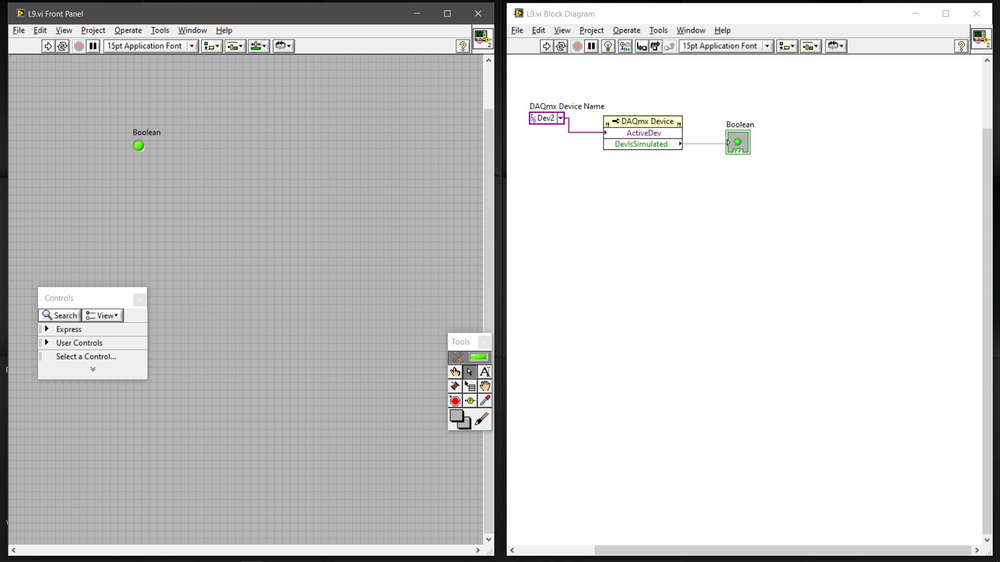
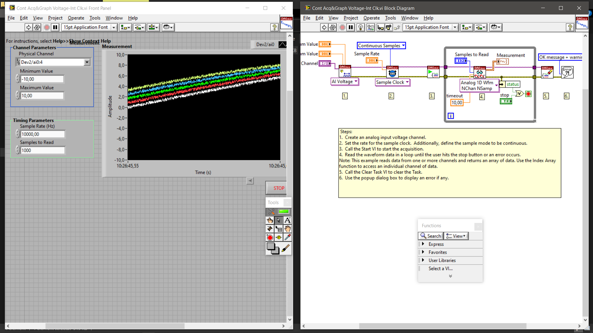

# Achiziția și Monitorizarea Semnalelor cu LabVIEW
# LabVIEW Signal Acquisition and Monitoring

## 🇷🇴 Română

### Descriere

Acest proiect prezintă două aplicații independente dezvoltate în **LabVIEW**, utilizând driverul **NI-DAQmx**, pentru monitorizarea proprietăților unui dispozitiv de achiziție de date National Instruments (DAQ) și pentru achiziția continuă a semnalelor analogice de tensiune.

Proiectul abordează două aspecte importante ale instrumentației virtuale:

1. Monitorizarea proprietăților și a stării unui dispozitiv DAQ.
2. Achiziția continuă a semnalelor analogice de tensiune și reprezentarea grafică a acestora.

Cele două aplicații ilustrează etape diferite ale lucrului cu echipamentele de achiziție de date: verificarea dispozitivului și achiziția propriu-zisă a semnalelor.

## Obiectivele proiectului

- Monitorizarea proprietăților unui dispozitiv NI-DAQ.
- Verificarea stării de simulare a dispozitivului.
- Configurarea unei achiziții analogice de tensiune.
- Realizarea achiziției continue folosind ceasul intern de eșantionare.
- Reprezentarea grafică a semnalelor achiziționate.

## Aplicațiile dezvoltate

### 1. Monitorizarea proprietăților dispozitivului NI-DAQ – `L9.vi`

### Scop

Această aplicație permite accesarea și monitorizarea proprietăților dispozitivului DAQ, utilizând proprietățile DAQmx.

### Implementare

Diagrama Block Diagram conține:

- Selectarea dispozitivului DAQ (`Dev2`).
- Un nod de proprietăți `DAQmx Device`.
- Accesarea proprietăților `ActiveDev` și `DevIsSimulated`.
- Afișarea unei valori Boolean asociate proprietății `DevIsSimulated`.

### Principiu de funcționare

Aplicația utilizează proprietățile dispozitivului pentru a verifica informații referitoare la configurația acestuia și la starea de simulare.

Indicatorul Boolean permite vizualizarea rezultatului asociat proprietății `DevIsSimulated`.

### Competențe demonstrate

- Utilizarea proprietăților DAQmx Device.
- Lucrul cu dispozitive National Instruments DAQ.
- Utilizarea nodurilor de proprietăți în LabVIEW.
- Gestionarea și afișarea valorilor Boolean.

---

### 2. Achiziția continuă și reprezentarea grafică a tensiunii – `Cont Acq&Graph Voltage-Int Clk.vi`

### Scop

Această aplicație implementează un sistem de achiziție continuă a semnalelor analogice de tensiune, utilizând ceasul intern de eșantionare și funcțiile NI-DAQmx.

Datele achiziționate sunt reprezentate grafic într-un Waveform Graph, permițând monitorizarea evoluției semnalelor în timp.

### Fluxul de achiziție

Implementarea urmărește următoarele etape:

1. **DAQmx Create Channel** – configurarea canalelor analogice de intrare pentru măsurarea tensiunii.
2. **DAQmx Timing** – configurarea sursei de temporizare, a frecvenței de eșantionare și a modului Continuous Samples.
3. **DAQmx Start Task** – inițializarea și pornirea achiziției.
4. **DAQmx Read** – citirea datelor într-o buclă repetitivă și transmiterea acestora către indicatorul grafic.
5. **DAQmx Clear Task** – eliberarea resurselor utilizate pentru achiziție.
6. **Error Handling** – afișarea eventualelor erori printr-un dialog.

Achiziția continuă se desfășoară până la apăsarea butonului STOP sau până la apariția unei erori.

### Funcționalități observabile

- Configurarea canalelor analogice de intrare.
- Definirea domeniului de măsurare a tensiunii.
- Configurarea ceasului intern de eșantionare.
- Achiziția continuă a datelor.
- Citirea datelor de tip Waveform.
- Reprezentarea grafică a semnalelor măsurate.
- Oprirea achiziției prin intermediul butonului STOP.
- Gestionarea erorilor și eliberarea resurselor DAQmx.

---
### Arhitectură

Proiect DAQ LabVIEW
        |
        +-----------------------+
        |                       |
   Aplicația 1             Aplicația 2
        |                       |
   Proprietățile      Achiziție de tensiune
dispozitivului DAQ          analogică
        |                       |
   ActiveDev            DAQmx Creare canal
   DevIsSimulated               |
        |               DAQmx Sincronizare
   Indicator boolean            |
                        DAQmx Pornire sarcină
                                |
                          DAQmx Citire
                                |
                       Grafic formă de undă
                                |
                          DAQmx Oprire

## Tehnologii și instrumente

| Tehnologie | Rol |
|---|---|
| LabVIEW | Dezvoltarea aplicațiilor și a interfeței grafice |
| NI-DAQmx | Configurarea și controlul achiziției de date |
| National Instruments DAQ | Hardware pentru achiziția semnalelor |
| Analog Input | Măsurarea tensiunilor analogice |
| Internal Sample Clock | Temporizarea achiziției |
| Waveform Graph | Reprezentarea grafică a semnalelor |

## Parametri tehnici

Parametrii documentați pentru aplicația de achiziție continuă sunt:

| Parametru | Valoare |
|---|---|
| Tipul măsurării | Analog Voltage |
| Canal(e) | Dev2/ai0:4 |
| Număr de canale | 5 |
| Domeniul de măsurare | -10 V ... +10 V |
| Sursa de temporizare | Internal Sample Clock |
| Mod de achiziție | Continuous Samples |
| Frecvență de eșantionare | 10.000 Hz |
| Număr de eșantioane citite | 1000 |
| Timeout pentru citire | 10 s |

### Structura proiectului

```text
Achizitie-si-Monitorizare-Semnale-LabVIEW/
│
├── README.md
├── p1.seproj
├── L9.vi
├── Cont Acq&Graph Voltage-Int Clk.vi
├── configData.nce
├── Documentation/
│   ├── documentatie.docx
│   └── documentatie.pdf
└── Images/
    ├── l9.png
    └── cont.png

```

### Capturi de ecran

**Monitorizarea proprietăților dispozitivului NI-DAQ**



**Achiziția continuă și reprezentarea grafică a tensiunii**



## Cerințe și instalare

### Cerințe software

- LabVIEW.
- Driver NI-DAQmx compatibil cu versiunea LabVIEW instalată.

### Cerințe hardware

- Dispozitiv National Instruments DAQ compatibil cu achiziția analogică de tensiune.
- Canale analogice de intrare disponibile.

### Pași pentru utilizare

1. Instalați LabVIEW.
2. Instalați driverul NI-DAQmx.
3. Conectați dispozitivul DAQ sau configurați un dispozitiv simulat.
4. Verificați identificatorul dispozitivului în NI MAX.
5. Deschideți fișierul `p1.seproj`.
6. Deschideți VI-ul dorit.
7. Verificați configurația hardware și parametrii înainte de rulare.

### Competențe tehnice demonstrate

- Programare grafică în LabVIEW.
- Utilizarea driverului NI-DAQmx.
- Configurarea canalelor analogice de intrare.
- Configurarea parametrilor de eșantionare.
- Achiziția continuă de date.
- Monitorizarea proprietăților hardware.
- Reprezentarea grafică a semnalelor.
- Organizarea și documentarea unui proiect tehnic.

---

## 🇬🇧 English

### Description

This project presents two applications developed in **LabVIEW**, using the **NI-DAQmx**, for monitoring National Instruments Data Acquisition (DAQ) devices properties and performing continuous analog voltage acquisition.

The project covers two important aspects of virtual instrumentation:

1. Monitoring DAQ device properties and simulation status.
2. Continuous analog voltage acquisition and graphical waveform visualization.

### Project Objectives

- Monitor NI-DAQ device properties.
- Check the simulation status of the device.
- Configure analog voltage acquisition.
- Perform continuous data acquisition using the internal sample clock.
- Display acquired signals graphically.

## Developed Applications

### 1. NI-DAQ Device Property Monitoring – `L9.vi`

### Purpose

This application accesses and monitors DAQ device properties using DAQmx properties.

### Implementation

The Block Diagram includes:

- DAQ device selection (`Dev2`).
- A `DAQmx Device` property node.
- Access to the `ActiveDev` and `DevIsSimulated` properties.
- A Boolean indicator connected to the `DevIsSimulated` property.

### Operating Principle

The application accesses device properties to retrieve information about the selected DAQ device and its simulation status.

The Boolean indicator displays the value associated with the `DevIsSimulated` property.

### Demonstrated Skills

- Working with DAQmx Device properties.
- National Instruments DAQ device interaction.
- Using property nodes in LabVIEW.
- Boolean data handling and visualization.

---

#### 2. Continuous Voltage Acquisition and Graphing – `Cont Acq&Graph Voltage-Int Clk.vi`

### Purpose

This application implements continuous analog voltage acquisition using the internal sample clock and NI-DAQmx functions.

The acquired data is displayed using a Waveform Graph, allowing the monitored signals to be visualized over time.

### Acquisition Workflow

The implementation follows these main stages:

1. **DAQmx Create Channel** – creates analog voltage input channels.
2. **DAQmx Timing** – configures the internal sample clock, sampling rate, and Continuous Samples mode.
3. **DAQmx Start Task** – starts the acquisition task.
4. **DAQmx Read** – continuously reads acquired waveform data inside a loop and sends it to the graph indicator.
5. **DAQmx Clear Task** – releases the resources associated with the acquisition task.
6. **Error Handling** – displays potential errors through a dialog.

The acquisition continues until the STOP button is pressed or an error occurs.

### Observable Features

- Analog input channel configuration.
- Voltage measurement range configuration.
- Internal sample clock configuration.
- Continuous data acquisition.
- Waveform data reading.
- Graphical signal visualization.
- User-controlled acquisition stop.
- Error handling and DAQmx resource cleanup.

---

### Architecture

LABVIEW DAQ PROJECT
        |
        +-----------------------+
        |                       |
   Application 1           Application 2
        |                       |
   DAQ Device              Analog Voltage
   Properties              Acquisition
        |                       |
   ActiveDev               DAQmx Create Channel
   DevIsSimulated               |
        |                  DAQmx Timing
   Boolean Indicator            |
                           DAQmx Start Task
                                |
                           DAQmx Read
                                |
                          Waveform Graph
                                |
                          DAQmx Clear Task

## Technologies and Tools

| Technology | Purpose |
|---|---|
| LabVIEW | Application and graphical interface development |
| NI-DAQmx | Data acquisition configuration and control |
| National Instruments DAQ | Signal acquisition hardware |
| Analog Input | Analog voltage measurement |
| Internal Sample Clock | Acquisition timing |
| Waveform Graph | Graphical signal visualization |

## Technical Parameters

The documented configuration for the continuous acquisition application includes:

| Parameter | Value |
|---|---|
| Measurement type | Analog Voltage |
| Channel(s) | Dev2/ai0:4 |
| Number of channels | 5 |
| Measurement range | -10 V ... +10 V |
| Timing source | Internal Sample Clock |
| Acquisition mode | Continuous Samples |
| Sampling rate | 10,000 Hz |
| Number of samples read | 1000 |
| Read timeout | 10 s |

### Project structure

```text
Achizitie-si-Monitorizare-Semnale-LabVIEW/
│
├── README.md
├── p1.seproj
├── L9.vi
├── Cont Acq&Graph Voltage-Int Clk.vi
├── configData.nce
├── Documentation/
│   ├── documentatie.docx
│   └── documentatie.pdf
└── Images/
    ├── l9.png
    └── cont.png
```

### Screenshots

**NI-DAQ Device Property Monitoring**


**Continuous Voltage Acquisition and Graphing**


## Requirements and Installation

### Software Requirements

- LabVIEW.
- NI-DAQmx driver compatible with the installed LabVIEW version.

### Hardware Requirements

- A National Instruments DAQ device supporting analog voltage acquisition.
- Available analog input channels.

### Getting Started

1. Install LabVIEW.
2. Install the NI-DAQmx driver.
3. Connect a DAQ device or configure a simulated device.
4. Verify the device identifier in NI Measurement & Automation Explorer (NI MAX).
5. Open `p1.seproj`.
6. Open the desired VI.
7. Verify the hardware configuration and acquisition parameters before execution.

### Technical Skills Demonstrated

- Graphical programming with LabVIEW.
- NI-DAQmx driver integration.
- Analog input channel configuration.
- Sampling parameter configuration.
- Continuous data acquisition.
- Hardware property monitoring.
- Signal visualization.
- Technical project organization and documentation.

---

## 👤 Autor / Author

**IonutD**
